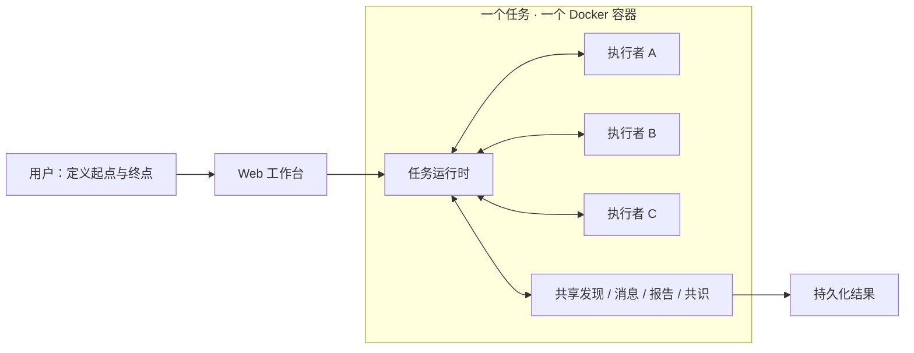

<div align="center">

# Nexora

**一个目标，多条探索路径。**

由平等 AI 执行者组成的自主探索工作空间。

[快速启动](#快速启动) · [核心能力](#核心能力) · [架构说明](docs/ARCHITECTURE.md) · [运维指南](docs/OPERATIONS.md)

</div>

---

Nexora 将一个开放任务交给多个可以独立行动、相互通信的执行者。你描述已知条件和期望终点，执行者自主选择方向、创建新的执行者、共享发现，并通过全体共识判断目标是否达成。

你可以在 Web 工作台中查看任务进度、阅读发现与报告、补充指令，或停止、恢复和继续任务。运行时负责状态、消息与执行生命周期；不预设固定分工，也不设置中央调度 agent。

> 当前处于早期开发阶段。Nexora 是单宿主部署的任务工作空间，尚不提供多用户账户、租户隔离或自动预算管理。

## 核心能力

| 能力 | 说明 |
| --- | --- |
| 自主协作 | 执行者自行选择方向、裂变、通信与退出，无需预先编排固定流程 |
| 共享发现 | 追加式记录探索成果，支持引用、替代关系和历史查询 |
| 人工介入 | 在运行中发送命令，追踪从保存、入队到进入模型上下文的状态 |
| 完成共识 | 全体参与者针对同一目标与共享状态明确同意，且无未结算活动后才完成 |
| 恢复与继续 | 中断后恢复会话；已结束任务可开启新轮次并保留发现、证据与报告 |
| 持久终端 | 支持交互式 shell、长连接与后台任务，跟踪终端和工具的生命周期 |
| 可追溯结果 | 保存版本化报告、消息、审计日志、模型用量与运行诊断 |
| Web 工作台 | 浅色 SaaS 风格界面，提供任务总览、搜索筛选、实时详情与模型配置 |

## 如何运行



每个执行者（`work`）拥有独立的 DeepSeek Harness 会话和进程。同一任务的执行者共享任务资料，运行时协调写入、消息投递和完成条件。执行者数量与方向由任务执行过程决定，图中的三个执行者仅用于说明结构。

**停止不等于完成，沉默也不等于同意。** 进程退出、工具返回或模型停止输出，都不会单独被视为目标已达成。完整协议见 [架构与完成条件](docs/ARCHITECTURE.md)。

## 快速启动

### 1. 准备环境

- Linux：Docker Engine 与支持 `include` 的 Docker Compose v2.20+。
- Windows：Docker Desktop 4.34+，使用 Linux 容器，并启用 **Settings → Resources → Network → Enable host networking**。
- 一组可用的模型 API 凭据；默认使用 DeepSeek。

通过 Docker 使用时，宿主机无需安装 Node.js。Web 与任务容器均使用 host 网络。

### 2. 获取项目并配置

```bash
git clone https://github.com/kksty/nexora.git
cd nexora
```

Linux / macOS shell：

```bash
cp .env.example .env
```

Windows PowerShell：

```powershell
Copy-Item .env.example .env
```

编辑 `.env`，填写 `DEEPSEEK_API_KEY`。也可以先启动，在工作台的「模型与 API 配置」中填写凭据、获取模型列表并检测连通性。已有 `.env` 时直接编辑，避免覆盖。

### 3. 启动工作台

```bash
docker compose up -d --build web
docker compose logs web
```

打开 **[http://127.0.0.1:43187](http://127.0.0.1:43187)**，使用启动日志中打印的访问令牌登录。

### 4. 创建第一个任务

点击「创建任务」，填写：

- **起始信息**：背景、已有资料、可用资源和约束。
- **终点信息**：希望得到的结果，以及可判断的完成条件。

例如，用一个无需外部系统访问的任务熟悉流程：

> **起始信息**：为一个三人开发团队设计每周技术分享机制，每次不超过 30 分钟，准备时间不超过 1 小时。
>
> **终点信息**：产出一份 Markdown 方案，包含四周选题、会议流程、轮值规则和效果评估方法，并发布报告。

启动后，在任务详情查看执行者、发现、消息、命令、共识及文件。运行时就绪表示服务已可用，不代表模型已经回答或任务已经完成。

## 常用配置

完整配置模板见 [`.env.example`](.env.example)。Web 保存的模型配置优先于环境变量。

| 变量 | 默认值 | 用途 |
| --- | --- | --- |
| `DEEPSEEK_API_KEY` | 空 | 模型 API 密钥 |
| `DEEPSEEK_BASE_URL` | 空 | 可选的模型接口地址 |
| `LIEBIAN_PROVIDER` | `deepseek-official` | 模型提供方 |
| `LIEBIAN_MODEL` | `deepseek-flash` | 模型名称 |
| `LIEBIAN_MODEL_CONCURRENCY` | `4` | 每个任务所有执行者合计的并发模型请求上限 |
| `LIEBIAN_WEB_HOST` | `127.0.0.1` | 工作台监听地址 |
| `LIEBIAN_WEB_PORT` | `43187` | 工作台端口 |
| `LIEBIAN_WEB_TOKEN` | 启动时随机生成 | 可指定固定访问令牌，至少 8 个字符 |
| `LIEBIAN_API_PORT_RANGE` | `43188-43287` | 任务管理 API 的回环端口范围 |

项目展示名称已更新为 **Nexora**。为保持现有部署兼容，CLI 命令、Docker 镜像与容器名称、MCP 命名空间及 `LIEBIAN_*` 环境变量仍保留 `liebian` 标识。

## 任务与日常操作

| 操作 | 行为 |
| --- | --- |
| 发送命令 | 在执行步骤边界投递；进入上下文不等于执行完成 |
| 修改起始 / 终点 | 更新任务定义并使旧共识失效 |
| 停止任务 | 写入停止状态并清理运行时 |
| 继续并发送 | 为已结束任务创建新轮次，保留共享资料 |
| 恢复工作 | 为仍处于 active、但没有参与执行者的任务创建承接执行者 |
| 启动运行时 | 尝试恢复中断的运行时与会话 |

```bash
# 查看服务与日志
docker compose ps
docker compose logs -f web

# 拉取代码后更新 Web 服务
git pull
docker compose up -d --build web

# 停止整个 Compose 项目中的服务
docker compose down
```

容器层面的停止不会代替任务状态操作；需要将任务标记为停止时，先使用工作台的「停止任务」。网络、CLI、交互终端与恢复流程见 [运维指南](docs/OPERATIONS.md)。

## 数据与运行边界

| 路径 | 内容 |
| --- | --- |
| `tasks/<id>/` | 任务定义、证据、状态、报告、日志与会话 |
| `.dsh/` | Harness 配置与凭据 |
| `compose/tasks.yaml` | 工作台生成的任务服务定义；初始文件为空 |
| `.scratch/` | 本地测试与探针临时数据 |

`.env`、`tasks/`、`.dsh/` 和 `.scratch/` 已由 Git 忽略。**运行后生成的 `compose/tasks.yaml` 可能包含模型凭据，不要提交或发布其运行时内容。** 备份数据时也应保护其中的凭据、对话与任务资料。

执行者可以执行命令、读写任务文件并访问网络；同一任务内的执行者不构成相互隔离的安全边界。Web 管理容器挂载 Docker socket，任务容器不挂载。host 网络共享宿主端口，任务还具备 `NET_RAW` / `NET_ADMIN` 能力，应在可信、适当隔离的环境中运行，并限制任务的授权范围。

模型调用会产生费用。并发限制不是费用预算，当前没有自动预算管理器。重启可以恢复持久会话，但不会恢复原有 PTY、TCP 连接或撤销外部副作用。

## 开发与验证

使用 Node.js **22.18+**，容器镜像使用 Node.js 24。后端为 TypeScript，前端为原生 HTML、CSS 与 ES modules，无前端构建步骤。

```bash
npm ci
npm run typecheck
npm test
```

自动测试使用假驱动或本地服务，不需要模型 API 凭据，也不需要 Docker。真实 Harness、终端与 Compose 探针另见 [验证说明](docs/VALIDATION.md)；测试通过不代表模型输出质量或外部网络可达性已经验证。

```text
src/core/          任务状态、生命周期、消息与共识
src/harness/       Harness 驱动、活动跟踪与并发控制
src/api/           HTTP 管理与协议接口
src/mcp/           执行者 MCP 工具
src/web/           Web 服务、模型配置与容器启动
src/web/public/    工作台前端
src/cli.ts         CLI 入口
tests/            自动化测试
scripts/          探针与诊断工具
```

## 进一步了解

- [架构与协议](docs/ARCHITECTURE.md)：执行模型、状态一致性、完成条件与已知边界。
- [运维指南](docs/OPERATIONS.md)：网络、端口、任务控制、终端、数据与重试幂等。
- [运行诊断](docs/DIAGNOSTICS.md)：模型耗时、工具事件、资源采样与日志汇总。
- [验证说明](docs/VALIDATION.md)：自动回归、真实环境探针及验证范围。

欢迎通过 [Issues](https://github.com/kksty/nexora/issues) 反馈问题或讨论改进。提交问题前请移除密钥、访问令牌和任务中的敏感信息；贡献代码时请附上复现步骤及相关测试结果。
